# scrollfx

**A folio of generative sections for React, Vue and Svelte, plotted stroke by stroke as the reader scrolls.**

<a href="https://scrollfx-ui.vercel.app">
  <picture>
    <source media="(prefers-color-scheme: dark)" srcset="docs/hero-dark.jpg" />
    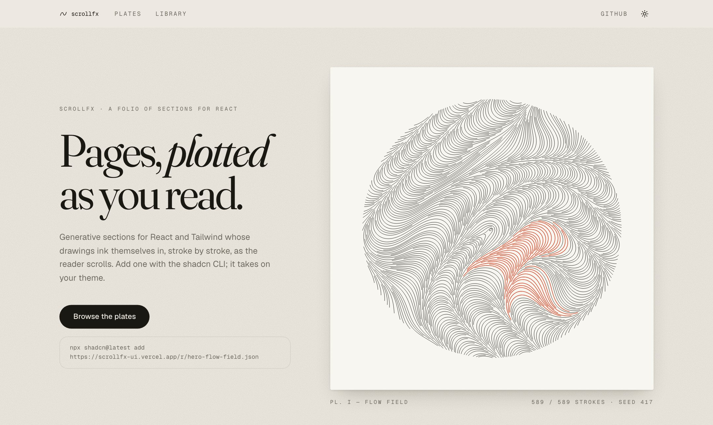
  </picture>
</a>

<p align="center"><b><a href="https://scrollfx-ui.vercel.app">See it live →</a></b></p>

Every section carries a line drawing made the way a pen plotter makes one: a flow field of several hundred
strokes, a contour map, a wireframe globe, hatching under a chart. As the reader arrives, a pen inks it in.
Add a section with the shadcn CLI and it takes on your theme: the blocks use only shadcn/ui's tokens
(`bg-background`, `bg-card`, `text-muted-foreground`, `border-border`), plus one accent colour you pass in.

<p align="center">
  
</p>

```bash
npx shadcn@latest add https://scrollfx-ui.vercel.app/r/hero-flow-field.json
```

The drawing runs on [svg-scroll-draw](https://github.com/DhruvilChauahan0210/ink-scroll), a scroll animation
library with no dependencies. The CLI installs it, and `lib/plotter.ts`, the generators every block draws with.

**Vue 3 and Svelte 5 too.** Every section has a Vue and a Svelte version, installed with the shadcn-vue and
shadcn-svelte CLIs:

```bash
npx shadcn-vue@latest add https://scrollfx-ui.vercel.app/r/vue/hero-flow-field.json
npx shadcn-svelte@latest add https://scrollfx-ui.vercel.app/r/svelte/hero-flow-field.json
```

## Plates

<table>
  <tr>
    <td width="50%" valign="top">
      <a href="https://scrollfx-ui.vercel.app/blocks/logos-plotted">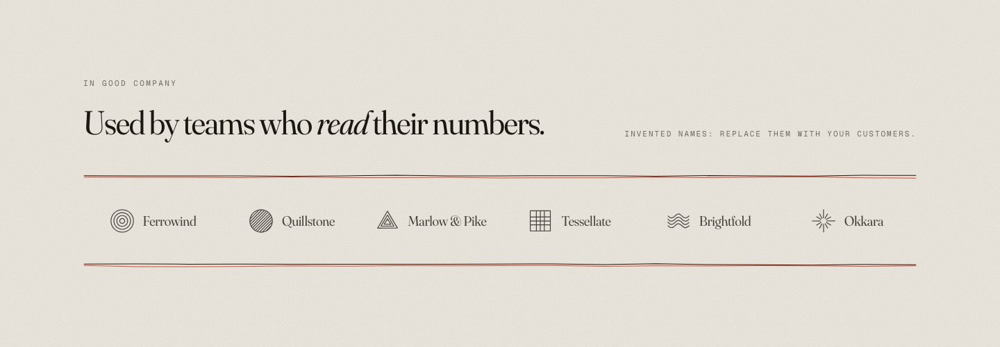</a>
      <br /><sub><b>Pl. II · Plotted logo cloud</b></sub>
    </td>
    <td width="50%" valign="top">
      <a href="https://scrollfx-ui.vercel.app/blocks/hatch-highlight">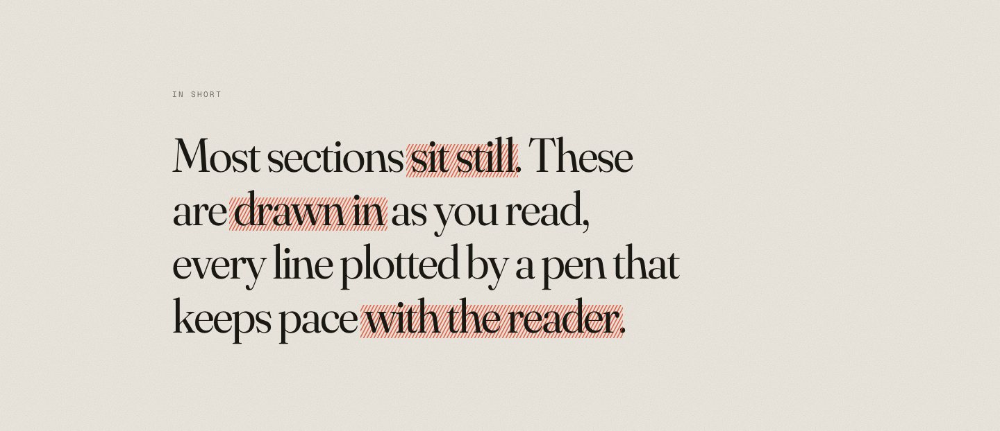</a>
      <br /><sub><b>Pl. III · Hatched highlight</b></sub>
    </td>
  </tr>
  <tr>
    <td width="50%" valign="top">
      <a href="https://scrollfx-ui.vercel.app/blocks/plotted-chart"></a>
      <br /><sub><b>Pl. IV · Plotted chart</b></sub>
    </td>
    <td width="50%" valign="top">
      <a href="https://scrollfx-ui.vercel.app/blocks/feature-plates">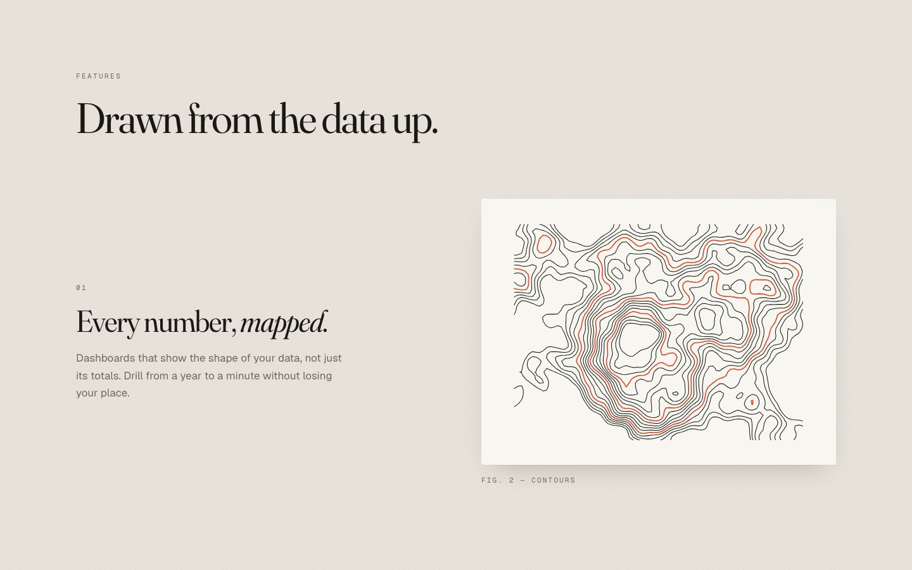</a>
      <br /><sub><b>Pl. V · Feature plates</b></sub>
    </td>
  </tr>
  <tr>
    <td width="50%" valign="top">
      <a href="https://scrollfx-ui.vercel.app/blocks/bento-plotted">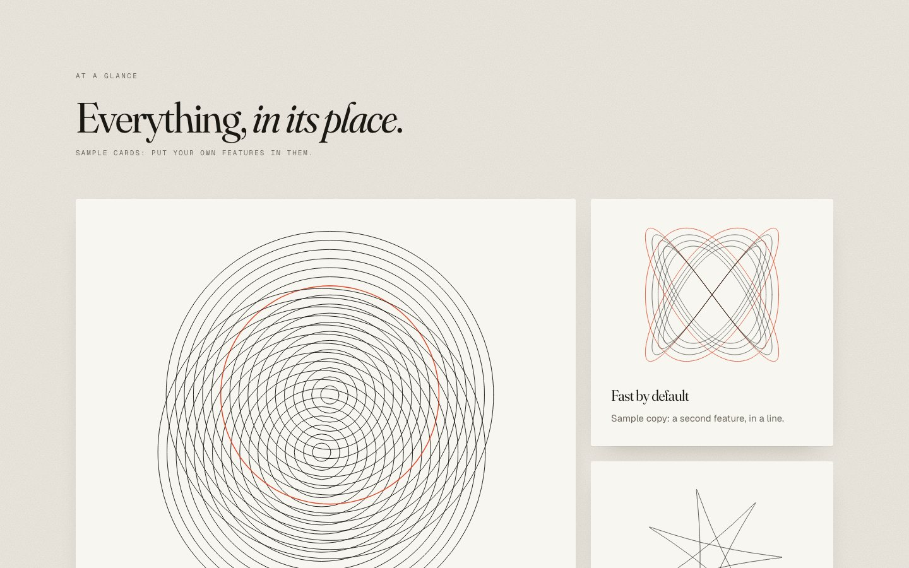</a>
      <br /><sub><b>Pl. VI · Plotted bento grid</b></sub>
    </td>
    <td width="50%" valign="top">
      <a href="https://scrollfx-ui.vercel.app/blocks/steps-route">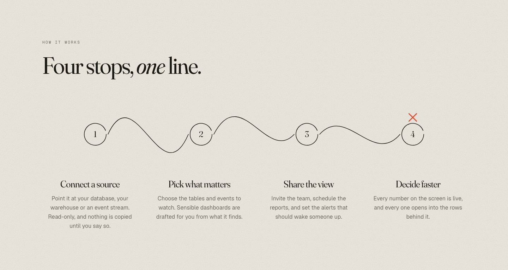</a>
      <br /><sub><b>Pl. VII · Steps on a route</b></sub>
    </td>
  </tr>
  <tr>
    <td width="50%" valign="top">
      <a href="https://scrollfx-ui.vercel.app/blocks/stats-plotted">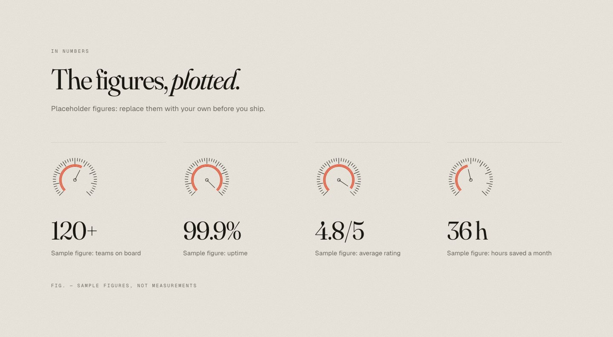</a>
      <br /><sub><b>Pl. VIII · Plotted stats</b></sub>
    </td>
    <td width="50%" valign="top">
      <a href="https://scrollfx-ui.vercel.app/blocks/changelog-plotted">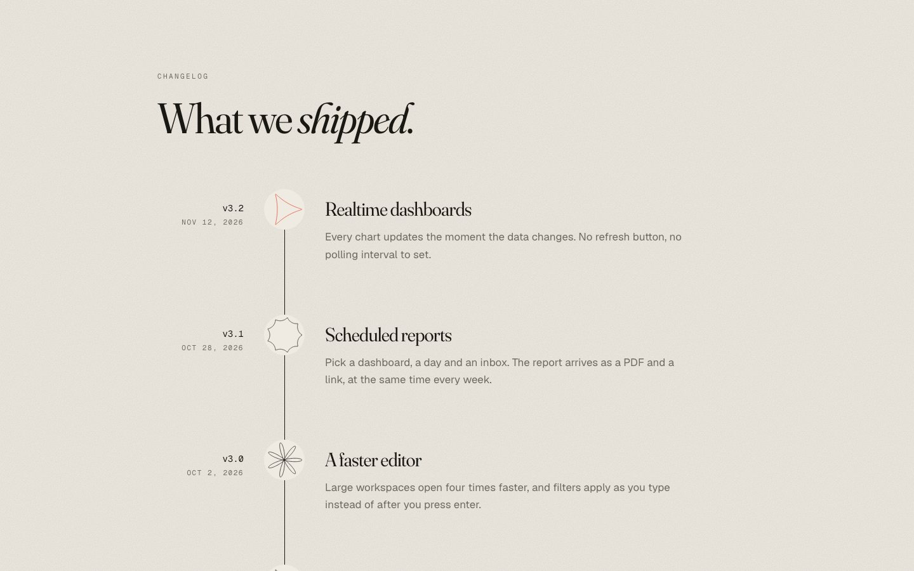</a>
      <br /><sub><b>Pl. IX · Plotted changelog</b></sub>
    </td>
  </tr>
  <tr>
    <td width="50%" valign="top">
      <a href="https://scrollfx-ui.vercel.app/blocks/pricing-plotted"></a>
      <br /><sub><b>Pl. X · Plotted pricing</b></sub>
    </td>
    <td width="50%" valign="top">
      <a href="https://scrollfx-ui.vercel.app/blocks/testimonials-plotted">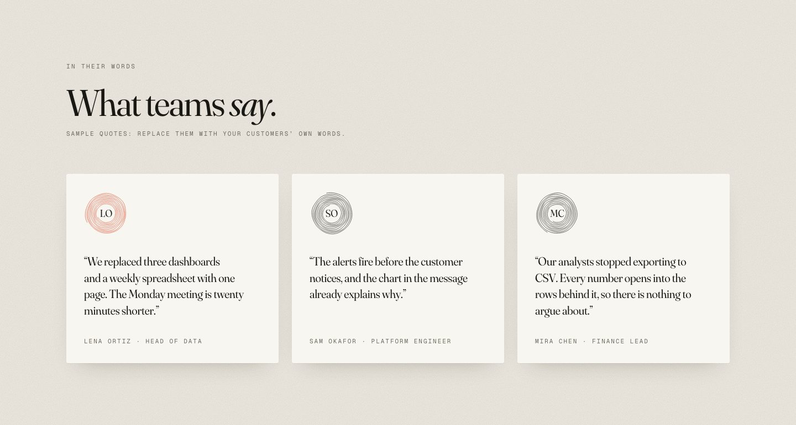</a>
      <br /><sub><b>Pl. XI · Plotted testimonials</b></sub>
    </td>
  </tr>
  <tr>
    <td width="50%" valign="top">
      <a href="https://scrollfx-ui.vercel.app/blocks/team-plotted">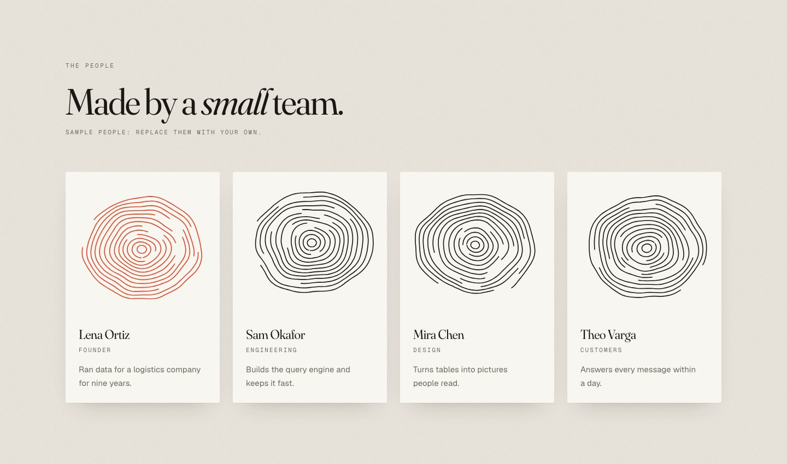</a>
      <br /><sub><b>Pl. XII · Team with fingerprints</b></sub>
    </td>
    <td width="50%" valign="top">
      <a href="https://scrollfx-ui.vercel.app/blocks/faq-plotted">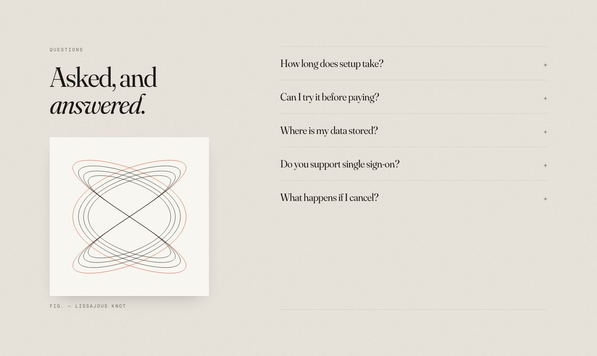</a>
      <br /><sub><b>Pl. XIII · Plotted FAQ</b></sub>
    </td>
  </tr>
  <tr>
    <td width="50%" valign="top">
      <a href="https://scrollfx-ui.vercel.app/blocks/newsletter-plotted">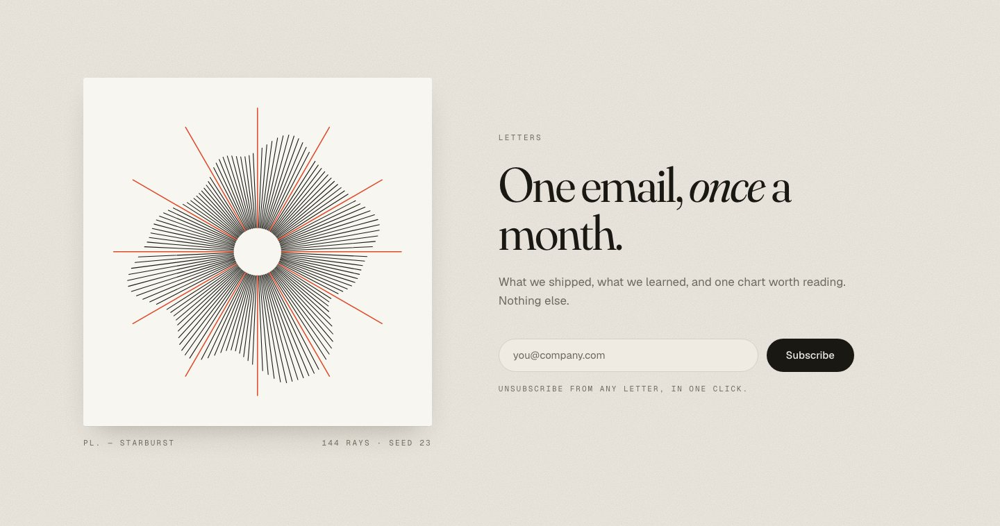</a>
      <br /><sub><b>Pl. XIV · Starburst sign-up</b></sub>
    </td>
    <td width="50%" valign="top">
      <a href="https://scrollfx-ui.vercel.app/blocks/cta-harmonograph"></a>
      <br /><sub><b>Pl. XV · Harmonograph call to action</b></sub>
    </td>
  </tr>
  <tr>
    <td width="50%" valign="top">
      <a href="https://scrollfx-ui.vercel.app/blocks/footer-plotted"></a>
      <br /><sub><b>Pl. XVI · Plotted footer</b></sub>
    </td>
  </tr>
</table>

| Plate | Block | What the pen draws | React | Vue | Svelte |
|---|---|---|---|---|---|
| I | **[Hero, flow field](https://scrollfx-ui.vercel.app/blocks/hero-flow-field)** | A round flow field, plotted top to bottom on arrival, with a live stroke count. | `npx shadcn@latest add https://scrollfx-ui.vercel.app/r/hero-flow-field.json` | `npx shadcn-vue@latest add https://scrollfx-ui.vercel.app/r/vue/hero-flow-field.json` | `npx shadcn-svelte@latest add https://scrollfx-ui.vercel.app/r/svelte/hero-flow-field.json` |
| II | **[Plotted logo cloud](https://scrollfx-ui.vercel.app/blocks/logos-plotted)** | Two rules drawn across the page, ink then accent, and a simple mark beside each name, plotted line by line. | `npx shadcn@latest add https://scrollfx-ui.vercel.app/r/logos-plotted.json` | `npx shadcn-vue@latest add https://scrollfx-ui.vercel.app/r/vue/logos-plotted.json` | `npx shadcn-svelte@latest add https://scrollfx-ui.vercel.app/r/svelte/logos-plotted.json` |
| III | **[Hatched highlight](https://scrollfx-ui.vercel.app/blocks/hatch-highlight)** | Diagonal hatching over the key phrases of a statement, as they are read. | `npx shadcn@latest add https://scrollfx-ui.vercel.app/r/hatch-highlight.json` | `npx shadcn-vue@latest add https://scrollfx-ui.vercel.app/r/vue/hatch-highlight.json` | `npx shadcn-svelte@latest add https://scrollfx-ui.vercel.app/r/svelte/hatch-highlight.json` |
| IV | **[Plotted chart](https://scrollfx-ui.vercel.app/blocks/plotted-chart)** | The area under a curve, hatched in from left to right, and the curve over it; the figures count up. | `npx shadcn@latest add https://scrollfx-ui.vercel.app/r/plotted-chart.json` | `npx shadcn-vue@latest add https://scrollfx-ui.vercel.app/r/vue/plotted-chart.json` | `npx shadcn-svelte@latest add https://scrollfx-ui.vercel.app/r/svelte/plotted-chart.json` |
| V | **[Feature plates](https://scrollfx-ui.vercel.app/blocks/feature-plates)** | A topographic map, a wireframe globe and a tunnel of turning squares, one per feature. | `npx shadcn@latest add https://scrollfx-ui.vercel.app/r/feature-plates.json` | `npx shadcn-vue@latest add https://scrollfx-ui.vercel.app/r/vue/feature-plates.json` | `npx shadcn-svelte@latest add https://scrollfx-ui.vercel.app/r/svelte/feature-plates.json` |
| VI | **[Plotted bento grid](https://scrollfx-ui.vercel.app/blocks/bento-plotted)** | A card each: a moiré of two ring sets, a Lissajous knot, a rosette, ridgelines and a globe. | `npx shadcn@latest add https://scrollfx-ui.vercel.app/r/bento-plotted.json` | `npx shadcn-vue@latest add https://scrollfx-ui.vercel.app/r/vue/bento-plotted.json` | `npx shadcn-svelte@latest add https://scrollfx-ui.vercel.app/r/svelte/bento-plotted.json` |
| VII | **[Steps on a route](https://scrollfx-ui.vercel.app/blocks/steps-route)** | Numbered stops a pen rings in turn, joined by a wandering line that ends on a cross. | `npx shadcn@latest add https://scrollfx-ui.vercel.app/r/steps-route.json` | `npx shadcn-vue@latest add https://scrollfx-ui.vercel.app/r/vue/steps-route.json` | `npx shadcn-svelte@latest add https://scrollfx-ui.vercel.app/r/svelte/steps-route.json` |
| VIII | **[Plotted stats](https://scrollfx-ui.vercel.app/blocks/stats-plotted)** | A gauge under each figure, ticked clockwise, with an accent band out to its share; the figures count up. | `npx shadcn@latest add https://scrollfx-ui.vercel.app/r/stats-plotted.json` | `npx shadcn-vue@latest add https://scrollfx-ui.vercel.app/r/vue/stats-plotted.json` | `npx shadcn-svelte@latest add https://scrollfx-ui.vercel.app/r/svelte/stats-plotted.json` |
| IX | **[Plotted changelog](https://scrollfx-ui.vercel.app/blocks/changelog-plotted)** | A rail that inks down as you read, and a rosette per release, seeded from its version. | `npx shadcn@latest add https://scrollfx-ui.vercel.app/r/changelog-plotted.json` | `npx shadcn-vue@latest add https://scrollfx-ui.vercel.app/r/vue/changelog-plotted.json` | `npx shadcn-svelte@latest add https://scrollfx-ui.vercel.app/r/svelte/changelog-plotted.json` |
| X | **[Plotted pricing](https://scrollfx-ui.vercel.app/blocks/pricing-plotted)** | Marks that grow denser with the plan, and a frame the pen goes round twice. Prices count up. | `npx shadcn@latest add https://scrollfx-ui.vercel.app/r/pricing-plotted.json` | `npx shadcn-vue@latest add https://scrollfx-ui.vercel.app/r/vue/pricing-plotted.json` | `npx shadcn-svelte@latest add https://scrollfx-ui.vercel.app/r/svelte/pricing-plotted.json` |
| XI | **[Plotted testimonials](https://scrollfx-ui.vercel.app/blocks/testimonials-plotted)** | Quotes on sheets, each stamped with a spiral seeded from the person's name, wound from the rim inward. | `npx shadcn@latest add https://scrollfx-ui.vercel.app/r/testimonials-plotted.json` | `npx shadcn-vue@latest add https://scrollfx-ui.vercel.app/r/vue/testimonials-plotted.json` | `npx shadcn-svelte@latest add https://scrollfx-ui.vercel.app/r/svelte/testimonials-plotted.json` |
| XII | **[Team with fingerprints](https://scrollfx-ui.vercel.app/blocks/team-plotted)** | People on sheets, each over a fingerprint seeded from their name, drawn ring by ring from the core outward. | `npx shadcn@latest add https://scrollfx-ui.vercel.app/r/team-plotted.json` | `npx shadcn-vue@latest add https://scrollfx-ui.vercel.app/r/vue/team-plotted.json` | `npx shadcn-svelte@latest add https://scrollfx-ui.vercel.app/r/svelte/team-plotted.json` |
| XIII | **[Plotted FAQ](https://scrollfx-ui.vercel.app/blocks/faq-plotted)** | Questions that open in place, beside a Lissajous knot the pen traces four times over. | `npx shadcn@latest add https://scrollfx-ui.vercel.app/r/faq-plotted.json` | `npx shadcn-vue@latest add https://scrollfx-ui.vercel.app/r/vue/faq-plotted.json` | `npx shadcn-svelte@latest add https://scrollfx-ui.vercel.app/r/svelte/faq-plotted.json` |
| XIV | **[Starburst sign-up](https://scrollfx-ui.vercel.app/blocks/newsletter-plotted)** | A plain HTML sign-up form beside a starburst the pen sweeps round clockwise, ray by ray. | `npx shadcn@latest add https://scrollfx-ui.vercel.app/r/newsletter-plotted.json` | `npx shadcn-vue@latest add https://scrollfx-ui.vercel.app/r/vue/newsletter-plotted.json` | `npx shadcn-svelte@latest add https://scrollfx-ui.vercel.app/r/svelte/newsletter-plotted.json` |
| XV | **[Harmonograph call to action](https://scrollfx-ui.vercel.app/blocks/cta-harmonograph)** | One unbroken line, the trace of two pendulums, spiralling in beside the closing call to action. | `npx shadcn@latest add https://scrollfx-ui.vercel.app/r/cta-harmonograph.json` | `npx shadcn-vue@latest add https://scrollfx-ui.vercel.app/r/vue/cta-harmonograph.json` | `npx shadcn-svelte@latest add https://scrollfx-ui.vercel.app/r/svelte/cta-harmonograph.json` |
| XVI | **[Plotted footer](https://scrollfx-ui.vercel.app/blocks/footer-plotted)** | A horizon of ridgelines plotted back to front, hidden lines removed, above the link columns. | `npx shadcn@latest add https://scrollfx-ui.vercel.app/r/footer-plotted.json` | `npx shadcn-vue@latest add https://scrollfx-ui.vercel.app/r/vue/footer-plotted.json` | `npx shadcn-svelte@latest add https://scrollfx-ui.vercel.app/r/svelte/footer-plotted.json` |

## Components — charts

Smaller pieces than the plates, to set inside your own pages: [scrollfx-ui.vercel.app/components](https://scrollfx-ui.vercel.app/components).
Each takes its data as props (series from a `config`, as shadcn's chart does), keeps its labels and a data table for
screen readers in the server HTML, and is inked in pen by pen as it scrolls in: the axes, then the hatching, then the
lines in the accent, the last pen lifting as it reaches the middle of the screen. React only for now.

| Component | Variants | Install |
|---|---|---|
| **[Line chart](https://scrollfx-ui.vercel.app/components/chart-line)** | single, multi-series, stepped (`curve`, `markers`) | `npx shadcn@latest add https://scrollfx-ui.vercel.app/r/chart-line.json` |
| **[Area chart](https://scrollfx-ui.vercel.app/components/chart-area)** | single, stacked (`stacked`); each band its own hatch | `npx shadcn@latest add https://scrollfx-ui.vercel.app/r/chart-area.json` |
| **[Bar chart](https://scrollfx-ui.vercel.app/components/chart-bar)** | vertical, horizontal, grouped, stacked (`orientation`, `stacked`) | `npx shadcn@latest add https://scrollfx-ui.vercel.app/r/chart-bar.json` |
| **[Pie chart](https://scrollfx-ui.vercel.app/components/chart-pie)** | pie, donut (`variant`); wedges shaded by hatching | `npx shadcn@latest add https://scrollfx-ui.vercel.app/r/chart-pie.json` |
| **[Radar chart](https://scrollfx-ui.vercel.app/components/chart-radar)** | one or more series, polygon or round grid (`grid`) | `npx shadcn@latest add https://scrollfx-ui.vercel.app/r/chart-radar.json` |
| **[Scatter chart](https://scrollfx-ui.vercel.app/components/chart-scatter)** | groups as marker shapes, optional trend line (`group`, `trend`) | `npx shadcn@latest add https://scrollfx-ui.vercel.app/r/chart-scatter.json` |
| **[Sparkline](https://scrollfx-ui.vercel.app/components/sparkline)** | line or hatched area, end dot (`variant`, `dot`) | `npx shadcn@latest add https://scrollfx-ui.vercel.app/r/sparkline.json` |

```tsx
import { ChartBar } from '@/components/scrollfx/chart-bar';

<ChartBar
  data={[{ quarter: 'Q1', new: 120, returning: 210 }, { quarter: 'Q2', new: 180, returning: 240 }]}
  index="quarter"
  config={{ new: { label: 'New' }, returning: { label: 'Returning' } }}
  stacked
/>
```

The CLI adds the component to `components/scrollfx/`, with `lib/chart.ts` (scales, ticks, curves, hatching and
the pens the charts share) and `lib/plotter.ts`.

## Components — ink

Smaller pieces than the plates, for any page: marks a pen makes on and around your own content. Each takes
`accent` (and most `color`, ink by default), `strokeWidth`, `seed`, and `trigger`: `scroll` (the default,
finishing as it reaches the middle of the screen) or `view` (played once as it comes into view). Variants are a
`variant` prop. React for now.

| Component | Variants | Install |
|---|---|---|
| **Ink highlight** — a mark on words in running text, one per line when they wrap | `underline` `double-underline` `circle` `box` `strike` `hatch-fill` | `npx shadcn@latest add https://scrollfx-ui.vercel.app/r/ink-highlight.json` |
| **Ink divider** — a rule drawn across the page | `straight` `wavy` `sketchy` `dotted` `with-label` | `npx shadcn@latest add https://scrollfx-ui.vercel.app/r/ink-divider.json` |
| **Ink frame** — a border drawn round any children | `rect` `rounded` `double` `corner-marks` | `npx shadcn@latest add https://scrollfx-ui.vercel.app/r/ink-frame.json` |
| **Ink progress** — a value plotted as it is reached | `bar` `ring` `gauge` | `npx shadcn@latest add https://scrollfx-ui.vercel.app/r/ink-progress.json` |
| **Ink stamp** — a plotted stamp round a word or two | `circle` `rectangle` `seal` | `npx shadcn@latest add https://scrollfx-ui.vercel.app/r/ink-stamp.json` |
| **Ink signature** — a name written stroke by stroke in Hershey's script, or your own paths | name, or `paths` | `npx shadcn@latest add https://scrollfx-ui.vercel.app/r/ink-signature.json` |
| **Ink arrow** — a hand-drawn arrow pointing at something | `straight` `curved` `looped` | `npx shadcn@latest add https://scrollfx-ui.vercel.app/r/ink-arrow.json` |

The CLI puts each in `components/scrollfx/` and installs `lib/plotter.ts` and `lib/ink.ts` beside it.

## What every block does

- **Takes props.** Copy, data, plans, releases, people, the seed and the accent colour are props with defaults. The
  sign-up form posts to the URL you pass, or hands the address to your own function; it sends nothing itself.
- **Stays put.** Drawings come from fixed seeds, so a page draws the same thing on every visit. Browsers may
  differ by a stroke or two (engines round `Math.sin` differently, and a flow field magnifies it). Drawings are
  generated in the browser, so a few hundred strokes never bloat the server HTML; the text is in the server HTML.
- **Finishes where it is read.** Every scroll-drawn picture draws as it rises and finishes as it reaches the
  middle of the screen: not before, not after. `scrollWindow()` in `lib/plotter.ts` solves the trigger for it,
  and `npm run check` measures it on desktop and on a phone.
- **Respects reduced motion.** With `prefers-reduced-motion`, every drawing is shown finished.
- **Is checked in a real browser.** `npm run check` serves the production build, scrolls every block in
  Chromium, and fails on any console error, any hydration warning, or a drawing that never finishes.

## Develop

```bash
npm install
npm run dev     # http://localhost:4400
npm run build   # the shadcn registry (public/r) and the site
npm run check   # every block and every component page, scrolled in Chromium
npm run check:vue     # every Vue block, compiled and scrolled in Chromium
npm run check:svelte  # every Svelte block, the same way
npm run readme:images  # the README's screenshots and GIF, from the live site (needs ffmpeg)
```

A block is a file in `registry/blocks/`, an entry in `registry.json`, and a line in `registry/previews.ts`; its Vue and
Svelte versions are `registry/vue/<name>.vue` and `registry/svelte/<name>.svelte`, published to `public/r/vue/` and
`public/r/svelte/` by `npm run registry`.
Generators live in `lib/plotter.ts`, published as the `plotter` registry item that every block depends on.

A component is a file in `registry/ui/` (a `registry:ui` item in `registry.json`, installed to
`components/scrollfx/<name>.tsx`), its examples in `registry/examples/<name>.tsx` (listed in
`registry/examples/index.ts`), and a family library such as `lib/chart.ts` if it shares one. Its page,
`/components/<name>`, is built from those: every example live with its code, the props read from its
`<Name>Props` interface, and its source.

## License

MIT. Use the blocks in any project, commercial included.
