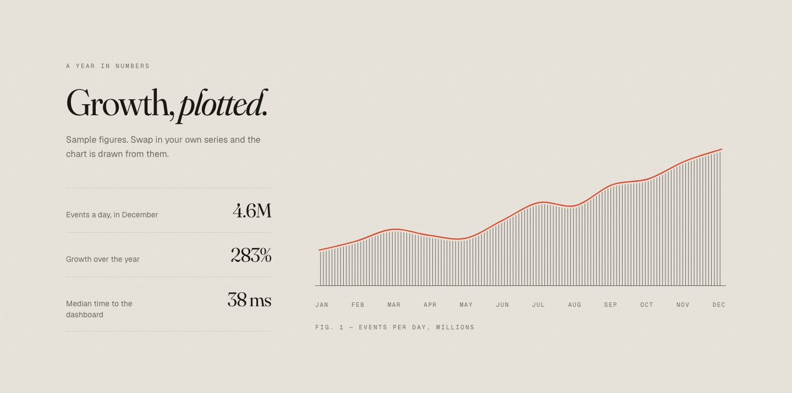
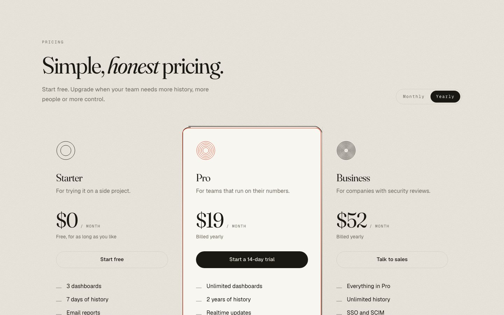
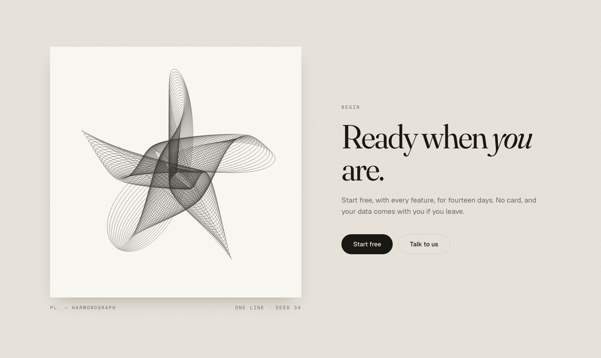
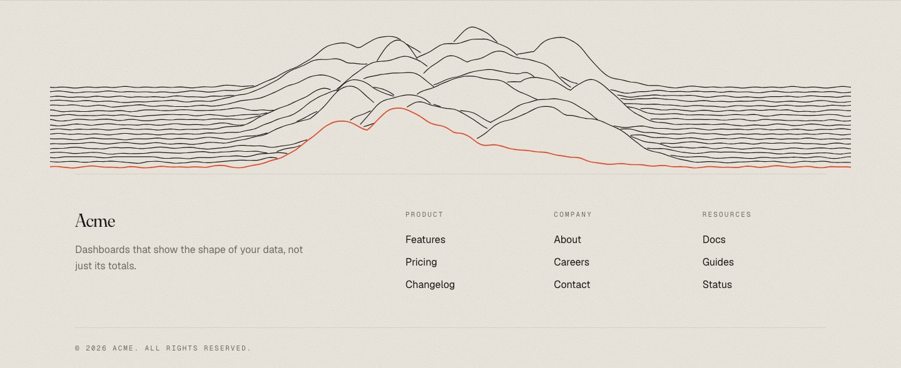

# scrollfx

**A folio of generative sections for React and Tailwind, plotted stroke by stroke as the reader scrolls.**

<a href="https://scrollfx-ui.vercel.app">
  <picture>
    <source media="(prefers-color-scheme: dark)" srcset="docs/hero-dark.jpg" />
    
  </picture>
</a>

<p align="center"><b><a href="https://scrollfx-ui.vercel.app">See it live →</a></b></p>

Every section carries a line drawing made the way a pen plotter makes one: a flow field of several hundred
strokes, a contour map, a wireframe globe, hatching under a chart. As the reader arrives, a pen inks it in.
Add a section with the shadcn CLI and it takes on your theme: the blocks use only shadcn/ui's tokens
(`bg-background`, `bg-card`, `text-muted-foreground`, `border-border`), plus one accent colour you pass in.

<p align="center">
  
</p>

```bash
npx shadcn@latest add https://scrollfx-ui.vercel.app/r/hero-flow-field.json
```

The drawing runs on [svg-scroll-draw](https://github.com/DhruvilChauahan0210/ink-scroll), a scroll animation
library with no dependencies. The CLI installs it, and `lib/plotter.ts`, the generators every block draws with.

## Plates

<table>
  <tr>
    <td width="50%" valign="top">
      <a href="https://scrollfx-ui.vercel.app/blocks/hatch-highlight"></a>
      <br /><sub><b>Pl. II · Hatched highlight</b></sub>
    </td>
    <td width="50%" valign="top">
      <a href="https://scrollfx-ui.vercel.app/blocks/plotted-chart"></a>
      <br /><sub><b>Pl. III · Plotted chart</b></sub>
    </td>
  </tr>
  <tr>
    <td width="50%" valign="top">
      <a href="https://scrollfx-ui.vercel.app/blocks/feature-plates"></a>
      <br /><sub><b>Pl. IV · Feature plates</b></sub>
    </td>
    <td width="50%" valign="top">
      <a href="https://scrollfx-ui.vercel.app/blocks/steps-route"></a>
      <br /><sub><b>Pl. V · Steps on a route</b></sub>
    </td>
  </tr>
  <tr>
    <td width="50%" valign="top">
      <a href="https://scrollfx-ui.vercel.app/blocks/changelog-plotted"></a>
      <br /><sub><b>Pl. VI · Plotted changelog</b></sub>
    </td>
    <td width="50%" valign="top">
      <a href="https://scrollfx-ui.vercel.app/blocks/pricing-plotted"></a>
      <br /><sub><b>Pl. VII · Plotted pricing</b></sub>
    </td>
  </tr>
  <tr>
    <td width="50%" valign="top">
      <a href="https://scrollfx-ui.vercel.app/blocks/testimonials-plotted"></a>
      <br /><sub><b>Pl. VIII · Plotted testimonials</b></sub>
    </td>
    <td width="50%" valign="top">
      <a href="https://scrollfx-ui.vercel.app/blocks/faq-plotted"></a>
      <br /><sub><b>Pl. IX · Plotted FAQ</b></sub>
    </td>
  </tr>
  <tr>
    <td width="50%" valign="top">
      <a href="https://scrollfx-ui.vercel.app/blocks/cta-harmonograph"></a>
      <br /><sub><b>Pl. X · Harmonograph call to action</b></sub>
    </td>
    <td width="50%" valign="top">
      <a href="https://scrollfx-ui.vercel.app/blocks/footer-plotted"></a>
      <br /><sub><b>Pl. XI · Plotted footer</b></sub>
    </td>
  </tr>
</table>

| Plate | Block | What the pen draws | Install |
|---|---|---|---|
| I | **[Hero, flow field](https://scrollfx-ui.vercel.app/blocks/hero-flow-field)** | A round flow field, plotted top to bottom on arrival, with a live stroke count. | `npx shadcn@latest add https://scrollfx-ui.vercel.app/r/hero-flow-field.json` |
| II | **[Hatched highlight](https://scrollfx-ui.vercel.app/blocks/hatch-highlight)** | Diagonal hatching over the key phrases of a statement, as they are read. | `npx shadcn@latest add https://scrollfx-ui.vercel.app/r/hatch-highlight.json` |
| III | **[Plotted chart](https://scrollfx-ui.vercel.app/blocks/plotted-chart)** | The area under a curve, hatched in from left to right, and the curve over it; the figures count up. | `npx shadcn@latest add https://scrollfx-ui.vercel.app/r/plotted-chart.json` |
| IV | **[Feature plates](https://scrollfx-ui.vercel.app/blocks/feature-plates)** | A topographic map, a wireframe globe and a tunnel of turning squares, one per feature. | `npx shadcn@latest add https://scrollfx-ui.vercel.app/r/feature-plates.json` |
| V | **[Steps on a route](https://scrollfx-ui.vercel.app/blocks/steps-route)** | Numbered stops a pen rings in turn, joined by a wandering line that ends on a cross. | `npx shadcn@latest add https://scrollfx-ui.vercel.app/r/steps-route.json` |
| VI | **[Plotted changelog](https://scrollfx-ui.vercel.app/blocks/changelog-plotted)** | A rail that inks down as you read, and a rosette per release, seeded from its version. | `npx shadcn@latest add https://scrollfx-ui.vercel.app/r/changelog-plotted.json` |
| VII | **[Plotted pricing](https://scrollfx-ui.vercel.app/blocks/pricing-plotted)** | Marks that grow denser with the plan, and a frame the pen goes round twice. Prices count up. | `npx shadcn@latest add https://scrollfx-ui.vercel.app/r/pricing-plotted.json` |
| VIII | **[Plotted testimonials](https://scrollfx-ui.vercel.app/blocks/testimonials-plotted)** | Quotes on sheets, each stamped with a spiral seeded from the person's name, wound from the rim inward. | `npx shadcn@latest add https://scrollfx-ui.vercel.app/r/testimonials-plotted.json` |
| IX | **[Plotted FAQ](https://scrollfx-ui.vercel.app/blocks/faq-plotted)** | Questions that open in place, beside a Lissajous knot the pen traces four times over. | `npx shadcn@latest add https://scrollfx-ui.vercel.app/r/faq-plotted.json` |
| X | **[Harmonograph call to action](https://scrollfx-ui.vercel.app/blocks/cta-harmonograph)** | One unbroken line, the trace of two pendulums, spiralling in beside the closing call to action. | `npx shadcn@latest add https://scrollfx-ui.vercel.app/r/cta-harmonograph.json` |
| XI | **[Plotted footer](https://scrollfx-ui.vercel.app/blocks/footer-plotted)** | A horizon of ridgelines plotted back to front, hidden lines removed, above the link columns. | `npx shadcn@latest add https://scrollfx-ui.vercel.app/r/footer-plotted.json` |

## What every block does

- **Takes props.** Copy, data, plans, releases, the seed and the accent colour are props with defaults.
- **Draws the same thing for everyone.** Drawings come from fixed seeds. They are generated in the browser, so a
  few hundred strokes never bloat the server HTML; the text is in the server HTML.
- **Finishes where it is read.** Every scroll-drawn picture draws as it rises and finishes as it reaches the
  middle of the screen: not before, not after. `scrollWindow()` in `lib/plotter.ts` solves the trigger for it,
  and `npm run check` measures it on desktop and on a phone.
- **Respects reduced motion.** With `prefers-reduced-motion`, every drawing is shown finished.
- **Is checked in a real browser.** `npm run check` serves the production build, scrolls every block in
  Chromium, and fails on any console error, any hydration warning, or a drawing that never finishes.

## Develop

```bash
npm install
npm run dev     # http://localhost:4400
npm run build   # the shadcn registry (public/r) and the site
npm run check   # every block, scrolled in Chromium
npm run readme:images  # the README's screenshots and GIF, from the live site (needs ffmpeg)
```

A block is a file in `registry/blocks/`, an entry in `registry.json`, and a line in `registry/previews.ts`.
Generators live in `lib/plotter.ts`, published as the `plotter` registry item that every block depends on.

## License

MIT. Use the blocks in any project, commercial included.
